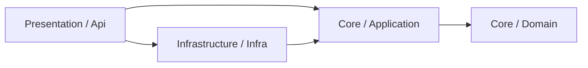
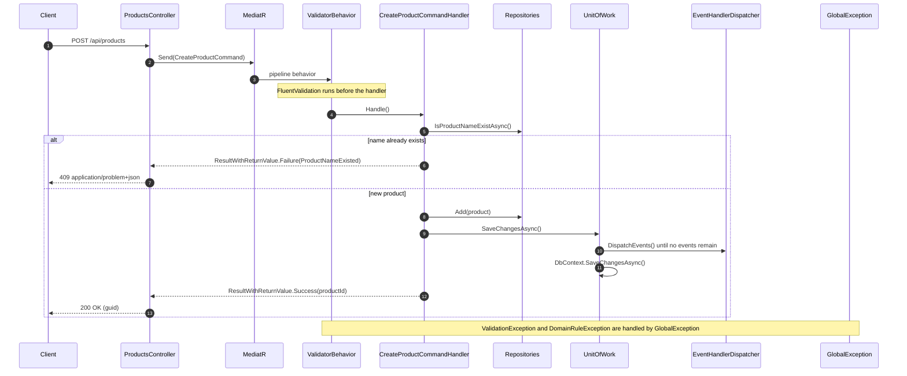
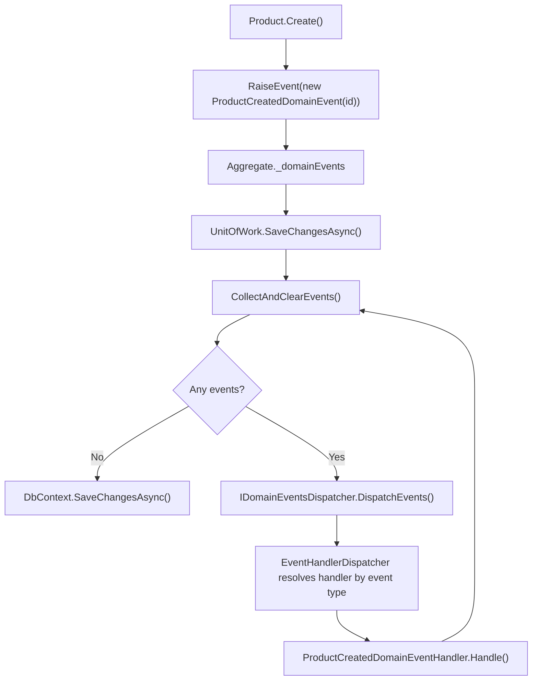

# Centralized Errors with ProblemDetails + Domain Events

A reference demo for two ideas that happen to share the same response envelope:

1. **Failure is modeled once and translated once** — every error is designed to leave the API as RFC 7807 `application/problem+json`, whether it is an expected business outcome (not found, duplicate name), a validation failure, a domain invariant violation, or an unhandled bug. (Two known gaps in the exception lane are documented below, with fixes.)
2. **Domain events are raised by aggregates and dispatched by the unit of work** — the domain publishes facts without knowing who consumes them, and the infrastructure decides when they run.

It is a single-feature (`Product`) codebase kept deliberately small so both mechanisms can be read end to end instead of inferred.

---

## Table of contents

- [Stack](#stack)
- [Architecture at a glance](#architecture-at-a-glance)
- [Request lifecycle](#request-lifecycle)
- [Deep dive: centralized error handling](#deep-dive-centralized-error-handling)
- [Deep dive: domain events](#deep-dive-domain-events)
- [Conventions and guardrails](#conventions-and-guardrails)
- [Getting started](#getting-started)
- [Known limitations and next steps](#known-limitations-and-next-steps)
- [File map](#file-map)
- [Summary](#summary)

---

## Stack

| Concern | Choice |
|---|---|
| Runtime | .NET 10 (`net10.0`) |
| Messaging | MediatR 14.3 |
| Validation | FluentValidation 12.2 |
| Persistence | EF Core 10.0.12 + Npgsql 10.0.3 (PostgreSQL) |
| API | ASP.NET Core controllers, `IExceptionHandler`, `ProblemDetails` |
| Solution format | `.slnx` (4 projects) |

No test project, no authentication, no container setup — intentionally out of scope.

---

## Architecture at a glance

```
CentralizedErrorWithProblemDetailsDemo.slnx
└── Src
    ├── Core
    │   ├── Domain            entities, domain events, domain exception
    │   └── Application       use cases, Result/Error model, validators, event contracts
    ├── Infrastructure
    │   └── Infra             EF Core + Npgsql, repositories, UnitOfWork, event dispatcher
    └── Presentation
        └── Api               controllers, ProblemDetails translation, global exception handler
```



| Project | Responsibility | May reference |
|---|---|---|
| `Core/Domain` | `Product` aggregate, `IDomainEvent`, `DomainRuleException`, `ErrorType` | nothing |
| `Core/Application` | Commands/queries/handlers, `Result`/`Error`, FluentValidation validators, event handler contracts | Domain |
| `Infrastructure/Infra` | `DemoDbContext`, repositories, `UnitOfWork`, `EventHandlerDispatcher` | Application, Domain |
| `Presentation/Api` | Controllers, ProblemDetails mapping, exception middleware, composition root | Application, Infra |

Dependency direction is clean (inward only), with one deliberate exception: `Api` references `Infra` so `Program.cs` can be the single composition root. Strict ports-and-adapters would move that wiring into a host project; for a demo, one fewer project is the right trade.

The Application layer is organized by **feature slice**, not by technical type:

```
Application/Features/Products/
    Commands/       CreateProduct, UpdateProductName, DeleteProduct (+ handlers)
    Queries/        GetProductById, GetAllProducts (+ handlers)
    Validators/     CreateProduct, UpdateProductName, GetAllProducts
```

Read and write models are separated: `IProductReadRepository` returns DTOs with `AsNoTracking()` (CQRS-lite), while `IProductWriteRepository` returns tracked `Product` aggregates for mutation.

---

## Request lifecycle

A command flows through validation, the handler, the unit of work, and back out as either a result or a ProblemDetails response.



Two failure lanes exist, and they are designed to converge on the same media type and envelope (the exception lane currently falls short on both — see [the exception-lane caveat](#exception-lane-caveat)):

| Lane | Trigger | Where it is decided | Response type |
|---|---|---|---|
| Expected failure | "not found", "duplicate name" | handler returns `Result.Failure(ProductErrors.X)` | `ProblemDetails` |
| Exceptional failure | validation, invariant, bug | exception bubbles to `GlobalException` | `ProblemDetails` / `ValidationProblemDetails` |

---

## Deep dive: centralized error handling

### The pieces

| Concern | File |
|---|---|
| Error value object | `Src/Core/Application/Common/Errors/Error.cs` |
| Error catalog | `Src/Core/Application/Common/Errors/ProductErrors.cs` |
| Error categories | `Src/Core/Domain/Enums/ErrorType.cs` |
| Result types | `Src/Core/Application/Common/Results/Result.cs`, `ResultWithReturnValue.cs` |
| Result → HTTP | `Src/Presentation/Api/Extensions/ActionResultExtention.cs` |
| Status/title mapping | `Src/Presentation/Api/Common/ErrorResponseMapper.cs` |
| ProblemDetails builder | `Src/Presentation/Api/Common/ProblemDetailsFactory.cs` |
| Presentation-level codes | `Src/Presentation/Api/Common/ApiErrorCodes.cs` |
| Exception lane | `Src/Presentation/Api/Middlewares/GlobalException.cs` |
| Validation → exception bridge | `Src/Core/Application/Behaviors/ValidatorBehavior.cs` |

### 1. The error vocabulary is transport-agnostic

```csharp
public sealed record Error(string ErrorCode, string ErrorMessage, ErrorType ErrorType);
```

`Error` lives in Application and knows nothing about HTTP. `ErrorType` is a four-value enum in Domain:

```csharp
public enum ErrorType { BadRequest, NotFound, Unauthorized, Conflict }
```

Every domain-specific error is declared once in a catalog, so codes and messages are not scattered across handlers:

```csharp
public static class ProductErrors
{
    public static readonly Error ProductNameExisted =
        new("PRODUCT.CONFLICT", "Product name is already existed", ErrorType.Conflict);

    public static readonly Error ProductNotFound =
        new("PRODUCT.NOT_FOUND", "Product not found", ErrorType.NotFound);
}
```

The dot-separated `RESOURCE.REASON` convention makes codes stable, greppable, and safe for clients to branch on.

`ApiErrorCodes` is the parallel catalog for failures that originate in the presentation layer (validation, domain rule, unhandled exception) and are not modeled as `Error` values:

```csharp
VALIDATION_ERROR, DOMAIN_RULE_VALIDATION, INTERNAL_SERVER_ERROR
```

### 2. Lane A — expected failure as a `Result`

Handlers never return HTTP concepts and never throw for expected outcomes:

```csharp
var isProductNameExist = await _productReadRepository.IsProductNameExistAsync(request.Name, ct);
if (isProductNameExist)
    return ResultWithReturnValue<Guid>.Failure(ProductErrors.ProductNameExisted);
```

- `Result` → success or one `Error`; used for commands without a payload.
- `ResultWithReturnValue<T>` → success carries `Value`; failure carries the same `Error`.

This is intentionally a single-error result. FluentValidation handles multi-error input problems separately (see Lane B), so `Result` does not need an error collection.

### 3. Lane A → HTTP: one extension, one mapping table, one builder

Controllers call exactly one method:

```csharp
[HttpPost]
public async Task<ActionResult<Guid>> CreateProduct([FromBody] CreateProductRequest request, CancellationToken ct)
{
    var command = new CreateProductCommand(request.Name, request.Description);
    var result = await _mediator.Send(command, ct);
    return this.ToActionResult(result);
}
```

`ActionResultExtensions` is the only place a `Result` becomes a response:

| Result | Response |
|---|---|
| `ResultWithReturnValue<T>.Success(value)` | `200 OK` with `value` |
| `Result.Success()` | `204 NoContent` |
| `Result*.Failure(error)` | ProblemDetails with mapped status |

`ErrorResponseMapper` is the single decision table for status codes and titles:

| `ErrorType` | Status | Title |
|---|---|---|
| `BadRequest` | `400` | Bad Request |
| `NotFound` | `404` | Not Found |
| `Unauthorized` | `401` | Unauthorized |
| `Conflict` | `409` | Conflict |
| *(default)* | `500` | Internal Server Error |

The default arm is a prepared extension point: `ErrorType` currently has no `InternalServerError` member, so every `Error` value maps to a 4xx today. Likewise the `statusCode >= 500` branches in `ToErrorActionResult` are unreachable until a 5xx category is added — they exist so the branch does not have to be written later.

`ProblemDetailsFactory` is the only place the response body is assembled:

```csharp
var problemDetails = new ProblemDetails
{
    Status = statusCode,
    Title = title,
    Detail = detail,
    Instance = httpContext.Request.Path
};

problemDetails.Extensions["traceId"] = httpContext.TraceIdentifier;
if (errorCode is not null) problemDetails.Extensions["errorCode"] = errorCode;
if (errors is not null) problemDetails.Extensions["errors"] = errors;
```

Two guarantees fall out of centralizing this:

- Every error response produced by the two custom lanes has a **`traceId`** for log correlation and an **`errorCode`** for clients.
- Internal details are masked: anything mapping to 5xx gets `"An Unexpected error occured."` and the generic `INTERNAL_SERVER_ERROR` code instead of the real message.

### 4. Lane B — exceptional failure via `IExceptionHandler`

Validation failures are raised before the handler executes:

```csharp
public async Task<TResponse> Handle(TRequest request, RequestHandlerDelegate<TResponse> next, CancellationToken ct)
{
    if (!_validators.Any()) return await next(ct);

    var validationContext = new ValidationContext<TRequest>(request);
    var validationResults = await Task.WhenAll(
        _validators.Select(v => v.ValidateAsync(validationContext, ct)));

    var validationErrors = validationResults.SelectMany(r => r.Errors).ToList();
    if (validationErrors.Count != 0) throw new ValidationException(validationErrors);

    return await next(ct);
}
```

The pipeline throws; the middleware translates. `GlobalException` is registered in `Program.cs`:

```csharp
builder.Services.AddExceptionHandler<GlobalException>();
builder.Services.AddProblemDetails();
...
app.UseExceptionHandler();
```

and holds the complete exception → response table:

| Exception | Status | Title | `errorCode` | `detail` |
|---|---|---|---|---|
| `ValidationException` | 400 | Validation Failed | `VALIDATION_ERROR` | generic + intended `errors` dictionary (see caveat) |
| `DomainRuleException` | 400 | Bad Request | `DOMAIN_RULE_VALIDATION` | the exception message |
| anything else | 500 | Internal Server Error | `INTERNAL_SERVER_ERROR` | generic, real exception logged only |

For validation, the error list is grouped into a `ValidationProblemDetails` keyed by property name:

```csharp
var errors = validationException.Errors
    .GroupBy(e => e.PropertyName)
    .ToDictionary(g => g.Key, g => g.Select(e => e.ErrorMessage).ToArray());
```

`GlobalException` sets `httpContext.Response.ContentType = "application/problem+json"` and then writes the object directly. It *aims* to use the same contract as the Result lane, but two implementation details break that intent in the current build — see [the exception-lane caveat](#exception-lane-caveat) in the response reference.

### 5. Which lane should I use?

| Situation | Use | Why |
|---|---|---|
| Request shape is wrong (missing, too short, malformed) | FluentValidation validator | Input contract concerns; produces the `errors` dictionary clients expect (once the exception-lane caveat is fixed) |
| An invariant must hold no matter who calls the aggregate | `DomainRuleException` inside the aggregate | The domain cannot be bypassed, and the rule lives with the data |
| The use case has an expected negative outcome (not found, duplicate) | `Result.Failure(...)` | Callers must branch on it; no stack trace, no log noise |
| A bug or infrastructure fault | let it bubble | 500 + logged exception + masked detail |

The deliberate overlap: `CreateProductCommandValidator` enforces `NotEmpty().MinimumLength(3)`, and `Product.ValidateName` enforces the same rule again (after trimming). That duplication is intentional — the validator protects the API boundary, the aggregate protects itself. The aggregate is also slightly stricter post-trim, which is why domain-rule 400s can occur even when the validator passes.

### 6. Response reference

Samples below were captured from a local run of the current build. The two lanes do **not** produce an identical envelope today:

| Lane | `Content-Type` | `traceId` source | `errorCode` |
|---|---|---|---|
| Result (`ToErrorActionResult`) | `application/problem+json` | `HttpContext.TraceIdentifier` (`0HN...`) | yes |
| Exception (`GlobalException`) | `application/json; charset=utf-8` — see caveat | `HttpContext.TraceIdentifier` (`0HN...`) | yes |
| Framework model binding (`AddProblemDetails`) | `application/problem+json` | `Activity.Current.Id` (`00-...-...`) | **no** |

**200 — created (Lane A success)**

```json
"f1425763-30ad-4bea-b1bf-9cb2844d793a"
```

**204 — command with no payload**

No body (delete, update-name).

**409 — duplicate name (Lane A)**

```json
{
  "title": "Conflict",
  "status": 409,
  "detail": "Product name is already existed",
  "instance": "/api/products",
  "traceId": "0HNQ25IO3GCD2:00000001",
  "errorCode": "PRODUCT.CONFLICT"
}
```

**400 — FluentValidation (Lane B), actual current output**

```json
{
  "title": "Validation Failed",
  "status": 400,
  "detail": "One or more validation occured.",
  "instance": "/api/products",
  "traceId": "0HNQ25I586DQ4:00000001",
  "errorCode": "VALIDATION_ERROR"
}
```

Note what is missing: there is no `errors` member, so the client is told validation failed but not which field or why — even though `GlobalException` built a `ValidationProblemDetails` with the grouped errors. See [the exception-lane caveat](#exception-lane-caveat) below.

**400 — domain rule (Lane B)**

```json
{
  "status": 400,
  "title": "Bad Request",
  "detail": "Product name must contain 3 or more characters length.",
  "instance": "/api/products/6f1d...",
  "traceId": "0HN7ABCDEF:00000004",
  "errorCode": "DOMAIN_RULE_VALIDATION"
}
```

**404 — not found (Lane A)**

```json
{
  "status": 404,
  "title": "Not Found",
  "detail": "Product not found",
  "instance": "/api/products/6f1d...",
  "traceId": "0HN7ABCDEF:00000005",
  "errorCode": "PRODUCT.NOT_FOUND"
}
```

**500 — unhandled (Lane B)**

```json
{
  "status": 500,
  "title": "Internal Server Error",
  "detail": "An unexpected error occurred.",
  "instance": "/api/products",
  "traceId": "0HN7ABCDEF:00000006",
  "errorCode": "INTERNAL_SERVER_ERROR"
}
```

#### Exception-lane caveat

`GlobalException` ends with:

```csharp
httpContext.Response.ContentType = "application/problem+json";
await httpContext.Response.WriteAsJsonAsync(problemDetails, cancellationToken);
```

Two issues follow from that one call:

1. **The media type is overwritten.** `WriteAsJsonAsync` sets `Content-Type: application/json; charset=utf-8` because no `contentType` argument is supplied, so the line above it has no effect.
2. **The derived type is erased.** `WriteAsJsonAsync<TValue>` infers `TValue` from the *static* type of `problemDetails`, which is declared as `ProblemDetails`. The serializer therefore only writes `ProblemDetails` members, and `ValidationProblemDetails.Errors` is silently dropped.

One change fixes both:

```csharp
await httpContext.Response.WriteAsJsonAsync(
    (object)problemDetails,                    // runtime type, so Errors is serialized
    contentType: "application/problem+json",   // keep the RFC 7807 media type
    cancellationToken: cancellationToken);
```

The `Response.ContentType` assignment above it then becomes redundant. With the fix, the validation request returns:

```json
{
  "title": "Validation Failed",
  "status": 400,
  "detail": "One or more validation occured.",
  "instance": "/api/products",
  "errors": {
    "Name": ["'Name' must not be empty.", "Invalid product name length."]
  },
  "traceId": "0HNQ25I586DQ4:00000001",
  "errorCode": "VALIDATION_ERROR"
}
```

Alternatively, delegate serialization to `IProblemDetailsService.WriteAsync(...)`, which applies the correct content type and handles polymorphic output for you.

### 7. Framework-generated errors are covered by `AddProblemDetails()`

Because the controllers are `[ApiController]`, model-binding failures (malformed JSON, wrong types) are short-circuited by the framework before any handler runs. `AddProblemDetails()` supplies a default `ProblemDetails` for those, so they still leave as RFC 7807 with `application/problem+json`, a `type` link, and a `traceId` extension. Observed shape:

```json
{
  "type": "https://tools.ietf.org/html/rfc9110#section-15.5.1",
  "title": "One or more validation errors occurred.",
  "status": 400,
  "errors": {
    "request": ["The request field is required."]
  },
  "traceId": "00-f20cdda3b5ea334b31b957be7f4ef871-9437c6850e2561bb-00"
}
```

Two asymmetries remain: there is no `errorCode`, and `traceId` comes from `Activity.Current` (W3C format `00-...-...`) rather than from `HttpContext.TraceIdentifier` (`0HN...`) as in the other two lanes. That makes the same field carry two different id formats depending on where the failure originated, which complicates log correlation.

To unify the binder path with the rest, set `ApiBehaviorOptions.InvalidModelStateResponseFactory` to route through `ProblemDetailsFactory`, or implement a custom `IProblemDetailsService`. This is a known gap, not an oversight in the handler code.

---

## Deep dive: domain events

### The idea

An aggregate records a fact ("this product was created") without knowing whether anyone listens, whether there is a database, or whether the listener sends an email. The unit of work decides when that fact is released.

### The pieces

| Concern | File |
|---|---|
| Marker interface | `Src/Core/Domain/Events/IDomainEvent.cs` |
| Concrete event | `Src/Core/Domain/Events/ProductCreatedDomainEvent.cs` |
| Aggregate base | `Src/Core/Domain/Entities/Aggregate.cs` |
| Publisher side | `Src/Core/Domain/Entities/Product.cs` |
| Handler contract | `Src/Core/Application/Interfaces/Events/IDomainEventHandler.cs` |
| Dispatcher contract | `Src/Core/Application/Interfaces/Events/IDomainEventsDispatcher.cs` |
| Handler example | `Src/Core/Application/Events/ProductCreatedDomainEventHandler.cs` |
| Dispatcher implementation | `Src/Infrastructure/Infra/Events/EventHandlerDispatcher.cs` |
| Dispatch trigger | `Src/Infrastructure/Infra/Repositories/UnitOfWork.cs` |
| DI registration | `Src/Core/Application/DependencyInjection.cs`, `Src/Infrastructure/Infra/DepedencyInjection.cs` |

### Raising an event

Events are `sealed record`s that carry primitives only — never entities, never `DbContext` handles:

```csharp
public sealed record ProductCreatedDomainEvent(Guid ProductId) : IDomainEvent;
```

The aggregate base keeps the list private and exposes only enumeration, so no caller can raise or remove events from outside:

```csharp
public abstract class Aggregate
{
    private readonly List<IDomainEvent> _domainEvents = new();
    public IReadOnlyCollection<IDomainEvent> DomainEvents => _domainEvents.AsReadOnly();

    protected void RaiseEvent(IDomainEvent domainEvent) { _domainEvents.Add(domainEvent); }
    public void ClearEvents() { _domainEvents.Clear(); }
}
```

`RaiseEvent` is `protected`: only the aggregate itself can record a fact. `ClearEvents` is public because infrastructure — not the aggregate — owns the lifecycle of the list.

The factory method is the only way to create a product, so the event cannot be forgotten:

```csharp
public static Product Create(string name, string description)
{
    name = ValidateName(name);
    var product = new Product(name, description);
    product.RaiseEvent(new ProductCreatedDomainEvent(product.Id));
    return product;
}
```

`Aggregate` also writes `"Event Raise."` / `"Events Cleared."` to the console. That is a teaching aid for this demo — watch the console while creating a product and the lifecycle is visible.

### Dispatching: collect → clear → dispatch → repeat

`UnitOfWork` owns the moment events run:

```csharp
public async Task SaveChangesAsync(CancellationToken ct)
{
    while (true)
    {
        var domainEvents = CollectAndClearEvents();
        if (domainEvents.Count == 0) break;             // quiescent: nothing left to publish

        await _domainEventsDispatcher.DispatchEvents(domainEvents, ct);
    }

    await _context.SaveChangesAsync(ct);
}

private List<IDomainEvent> CollectAndClearEvents()
{
    var aggregates = _context.ChangeTracker
        .Entries<Aggregate>()
        .Select(entry => entry.Entity)
        .Where(aggregate => aggregate.DomainEvents.Count > 0)
        .ToList();

    var domainEvents = aggregates.SelectMany(a => a.DomainEvents).ToList();

    foreach (var aggregate in aggregates)
        aggregate.ClearEvents();

    return domainEvents;
}
```



Three deliberate design choices:

1. **Clear before dispatch.** If a handler throws, the already-collected events are not re-fired on a later attempt. The console order (`Events Cleared.` then `Event Handler executing.`) is this guard working, not a bug.
2. **Loop until quiescent.** A handler may raise a further event or create another aggregate that raises one; the next iteration picks it up before anything is committed. This makes event chains work inside a single unit of work.
3. **Dispatch before `SaveChanges`.** Handlers see the aggregate graph exactly as it will be persisted, and the final `SaveChanges` writes handler-made mutations too. The trade-off is that handlers do not see the row in the database yet (see caveats).

### Resolving handlers without generics at the call site

`EventHandlerDispatcher` lives in infrastructure and uses reflection so Application never sees `IServiceProvider`:

```csharp
foreach (var domainEvent in domainEvents)
{
    var handlerType = typeof(IDomainEventHandler<>).MakeGenericType(domainEvent.GetType());

    foreach (var handler in _serviceProvider.GetServices(handlerType))
    {
        var method = handlerType.GetMethod(nameof(IDomainEventHandler<>.Handle));
        await (Task)method!.Invoke(handler, new object[] { domainEvent, ct })!;
    }
}
```

`GetServices(handlerType)` returns **all** registrations, so multiple handlers per event work with no extra code. Registration stays explicit and greppable:

```csharp
services.AddScoped<IDomainEventHandler<ProductCreatedDomainEvent>, ProductCreatedDomainEventHandler>();
```

Because the dispatcher takes the scoped `IServiceProvider` rather than the handler list, a future handler may depend on `IUnitOfWork` without creating a constructor cycle — the unit of work is already constructed by dispatch time.

### Trade-off: custom dispatcher vs MediatR `INotification`

| | Custom `IDomainEvent` + reflection dispatcher (this demo) | MediatR `INotification` |
|---|---|---|
| Domain purity | Domain has zero third-party dependencies | Domain references MediatR |
| Registration | Explicit, one line per handler | Assembly scanning, implicit |
| Multi-handler | Supported via `GetServices` | Supported natively |
| Failure semantics | Plain `await`, exceptions propagate | `Publish` with custom `INotificationPublisher` |
| Discoverability | Reflection + a marker interface | Familiar to most .NET teams |
| Cost | Type activation per dispatch | Pre-compiled wrappers, slightly faster |

The custom version is chosen here because it demonstrates the mechanics — and because keeping Domain package-free is a real constraint in many shops.

### Runtime semantics

| Property | Behaviour |
|---|---|
| Ordering | Raise order per aggregate, then aggregate order as returned by the change tracker |
| Exactly-once | Each event instance is dispatched once per raise (cleared before dispatch) |
| Chaining | New events raised during dispatch are handled in the same loop |
| Failure | A throwing handler aborts the loop; `SaveChanges` never runs |
| Durability | **None** — events live in memory only; a crash before commit loses them |
| Persistence | No outbox table; events are not stored |

### Caveats and hardening

1. **Handlers run against uncommitted state.** Querying `Products` for the id in the event returns nothing, because the INSERT has not happened yet. Events therefore carry primitives (`ProductId`) so handlers do not need that read.
2. **No atomicity across the handler and the write.** If `DbContext.SaveChangesAsync` fails (for example, the unique index on `Product.Name` rejects a concurrent duplicate), a handler has already run for a product that was never stored. Wrap the whole sequence in a transaction to make the database side atomic:

   ```csharp
   public async Task SaveChangesAsync(CancellationToken ct)
   {
       await using var transaction = await _context.Database.BeginTransactionAsync(ct);

       while (true)
       {
           var domainEvents = CollectAndClearEvents();
           if (domainEvents.Count == 0) break;
           await _domainEventsDispatcher.DispatchEvents(domainEvents, ct);
       }

       await _context.SaveChangesAsync(ct);
       await transaction.CommitAsync(ct);
   }
   ```

   A transaction still cannot roll back an email or HTTP call — only an **outbox** (persist events alongside the entity, publish afterwards) makes external side effects safe. That is the natural next step for production.
3. **No loop guard.** A handler that re-raises on every dispatch (for example, one that mutates an aggregate and raises `ProductUpdatedDomainEvent`) loops forever. Add a max-iteration counter or a depth limit.
4. **Never call `SaveChangesAsync` from inside a handler.** It re-enters the loop and nests saves. Treat the unit of work as request-scoped and handler-read-only.
5. **Only creation raises an event.** `UpdateProductName` and delete are silent; `ProductUpdatedDomainEvent` / `ProductDeletedDomainEvent` are obvious additions that follow the same pattern.

---

## Conventions and guardrails

| Task | Where it goes | Rule |
|---|---|---|
| Add a new expected error | `ProductErrors` (or a new `XErrors` catalog) | Never inline a `new Error(...)` in a handler |
| Add a new error category | `Domain/Enums/ErrorType` + `ErrorResponseMapper` | Keep the mapping exhaustive and in one switch |
| Add a field to every error body | `ProblemDetailsFactory` only | Never hand-build `ProblemDetails` in a controller |
| Add a new exception type to handle | `GlobalException.TryHandleAsync` switch | Keep details masked for 5xx |
| Add a domain fact | `sealed record XDomainEvent` + `RaiseEvent` inside the aggregate | Events carry primitives only |
| Add a reaction to a fact | `IDomainEventHandler<T>` + one DI line | No `DbContext` calls in the domain |

Controller rules:

- The action calls `_mediator.Send(...)` and returns `this.ToActionResult(result)`. Nothing else.
- No `try/catch` in controllers — the exception handler owns that.
- No HTTP status codes in Application — `ErrorType` owns that.

Handler rules:

- Return `Result`/`ResultWithReturnValue<T>` for expected outcomes; throw only for genuine violations.
- Never touch `HttpContext`, `ProblemDetails`, or status codes.

Aggregate rules:

- Private setters, private constructor, static factory. State changes go through methods that validate.
- Only the aggregate raises its own events.

---

## Getting started

### Prerequisites

- .NET 10 SDK (`dotnet --version` → `10.0.x`)
- PostgreSQL running locally
- EF Core CLI: `dotnet tool install --global dotnet-ef`

### 1. Configure the database

`Src/Presentation/Api/appsettings.json` holds the connection string:

```json
"ConnectionStrings": {
  "DefaultConnection": "Host=localhost;Port=5432;Database=CentralizedErrorDemo;Username=postgres;Password=YOUR_PASSWORD"
}
```

The committed file contains a local demo credential. Replace it — preferably with user-secrets or an environment variable, since the API reads configuration at startup:

```powershell
dotnet user-secrets init --project Src/Presentation/Api
dotnet user-secrets set "ConnectionStrings:DefaultConnection" "Host=localhost;Port=5432;Database=CentralizedErrorDemo;Username=postgres;Password=***" --project Src/Presentation/Api
```

### 2. Apply the migration

A single `Init` migration creates the `Products` table with a unique index on `Name`:

```powershell
dotnet ef database update `
  --project Src/Infrastructure/Infra `
  --startup-project Src/Presentation/Api
```

### 3. Run

```powershell
dotnet run --project Src/Presentation/Api --launch-profile https
```

- HTTPS: `https://localhost:7272`
- HTTP: `http://localhost:5231`
- OpenAPI document (Development only): `GET /openapi/v1.json` — there is no Swagger UI wired up.

### 4. Exercise the endpoints

All five use cases are exposed and follow the same controller pattern (`Send` → `ToActionResult`):

| Method | Route | Success | Failure |
|---|---|---|---|
| `POST` | `/api/products` | `200` + `guid` | `400` validation, `409` `PRODUCT.CONFLICT` |
| `GET` | `/api/products?page=1&pageSize=10` | `200` + `PaginationResponse` | `400` validation (`page < 1` or `pageSize` outside `1..100`) |
| `GET` | `/api/products/{id}` | `200` + `ProductResponse` | `404` `PRODUCT.NOT_FOUND` |
| `PUT` | `/api/products/{id}/name` | `204` | `404`, `400` validation, `400` `DOMAIN_RULE_VALIDATION` |
| `DELETE` | `/api/products/{id}` | `204` | `404` `PRODUCT.NOT_FOUND` |

```http
POST https://localhost:7272/api/products
Content-Type: application/json

{ "name": "Mechanical Keyboard", "description": "Tactile switches" }
```

```http
GET https://localhost:7272/api/products?page=1&pageSize=10
```

```http
PUT https://localhost:7272/api/products/{id}/name
Content-Type: application/json

{ "newProductName": "Renamed Keyboard" }
```

```http
DELETE https://localhost:7272/api/products/{id}
```

The same requests are collected in `Src/Presentation/Api/Api.http`, including the negative cases.

Two distinct 400s are reachable on the rename endpoint:

- `{"newProductName": ""}` or `{"newProductName": "ab"}` → `VALIDATION_ERROR` from `UpdateProductNameCommandValidator`.
- `{"newProductName": "  a  "}` → `DOMAIN_RULE_VALIDATION`. The validator sees a valid five-character string; the aggregate trims it to `"a"` and rejects it. This is the intentional validator/domain overlap described in the error deep dive.

The console shows the domain-event lifecycle on create:

```
Event Raise.
Events Cleared.
info: Application.Events.ProductCreatedDomainEventHandler[0]
      Event Handler executing.
 New Product id <guid> added. 
 Ikaw na bahala sa logic.
```

The order is the design working: the event is cleared from the aggregate before the handler runs, and the EF Core `INSERT` is logged only after the handler completes. (The last line is placeholder text in the handler — replace it with real work.)

Validation responses on `POST` and `PUT` still omit the per-field `errors` dictionary until [the exception-lane caveat](#exception-lane-caveat) is fixed; the status code and `errorCode` are correct.

---

## Known limitations and next steps

Ordered from "affects the demo narrative" to "production hygiene".

**Behavioural / architectural**

- **Check-then-act duplicate check.** `IsProductNameExistAsync` followed by `Add` is a TOCTOU race. Under concurrency the unique index throws `DbUpdateException`, which is unmapped — so the race surfaces as `500 INTERNAL_SERVER_ERROR` instead of `409 PRODUCT.CONFLICT`. Add a `DbUpdateException` case in `GlobalException` (or catch it in the handler) that maps unique-violation SQL state `23505` to `ProductErrors.ProductNameExisted`. This is the clearest example of where the Result lane stops being sufficient.
- **The exception lane drops `ValidationProblemDetails.Errors` and the RFC 7807 media type.** Because `GlobalException` serializes a `ProblemDetails`-typed variable without a `contentType`, validation responses are `application/json` and contain no per-field `errors`. Both are fixed by the one-line `WriteAsJsonAsync` change in [the exception-lane caveat](#exception-lane-caveat).
- **No transaction around the dispatch loop.** See the transaction snippet in the domain-events caveats. Handler side effects and the write are not atomic.
- **No event durability / outbox.** Events are in-memory only and cannot survive a crash between dispatch and commit.
- **No loop guard** on the dispatch loop.
- **Only `ProductCreated` exists.** Update and delete raise nothing.
- **Model-binding errors bypass the custom factory.** Malformed JSON produces default `ProblemDetails` without `errorCode`, and with a W3C-format `traceId` rather than `HttpContext.TraceIdentifier` (see the error deep dive).
- **`Result` allows inconsistent construction.** The protected constructor does not prevent a derived type from creating success-with-error; both factories are correct today, but a guard or private constructors would make it impossible.

**Hygiene / polish**

- `Api.http` still targets the template's `/weatherforecast` route.
- Handler log says "New Product id added" although it runs before the row is persisted.
- Typos in strings: `"One or more validation occured."`, `"An Unexpected error occured."`, and identifier/directory typos `DepedencyInjection`, `ActionResultExtention.cs`, namespace `Application.Interfaces.Uof`.
- No tests — unit tests for `Result` → status mapping and an integration test per error lane would lock the contract.
- No authentication/authorization despite `ErrorType.Unauthorized` and `UseAuthorization()` being wired.
- No Swagger UI, no rate limiting, no health checks.
- Local database credential is committed in `appsettings.json`.

---

## File map

| Path | Why read it |
|---|---|
| `Src/Presentation/Api/Controllers/ProductsController.cs` | The five endpoints; HTTP verbs meet use cases here and nowhere else |
| `Src/Core/Application/Features/Products/Validators/` | One validator per command/query, auto-discovered by assembly scan |
| `Src/Core/Application/Common/Errors/Error.cs` | The transport-agnostic error record |
| `Src/Core/Application/Common/Errors/ProductErrors.cs` | Error catalog and code convention |
| `Src/Core/Domain/Enums/ErrorType.cs` | The four semantic categories |
| `Src/Core/Application/Common/Results/Result.cs` | Success/failure primitive |
| `Src/Core/Application/Common/Results/ResultWithReturnValue.cs` | Result with payload |
| `Src/Presentation/Api/Extensions/ActionResultExtention.cs` | Result → HTTP translation |
| `Src/Presentation/Api/Common/ErrorResponseMapper.cs` | `ErrorType` → status/title table |
| `Src/Presentation/Api/Common/ProblemDetailsFactory.cs` | Single ProblemDetails builder (`traceId`, `errorCode`, `errors`) |
| `Src/Presentation/Api/Common/ApiErrorCodes.cs` | Codes for presentation-layer failures |
| `Src/Presentation/Api/Middlewares/GlobalException.cs` | Exception → ProblemDetails table |
| `Src/Core/Application/Behaviors/ValidatorBehavior.cs` | FluentValidation → `ValidationException` bridge |
| `Src/Core/Application/Features/Products/Commands/CreateProductCommandHandler.cs` | Result lane in a handler; raises the domain event |
| `Src/Core/Domain/Entities/Aggregate.cs` | Event list, `RaiseEvent`, `ClearEvents` |
| `Src/Core/Domain/Entities/Product.cs` | Factory + invariants + event raising |
| `Src/Core/Domain/Events/ProductCreatedDomainEvent.cs` | Event shape (record, primitives only) |
| `Src/Core/Application/Interfaces/Events/IDomainEventHandler.cs` | Handler contract |
| `Src/Infrastructure/Infra/Events/EventHandlerDispatcher.cs` | Reflection-based multi-handler dispatch |
| `Src/Infrastructure/Infra/Repositories/UnitOfWork.cs` | Collect → clear → dispatch loop, then save |
| `Src/Presentation/Api/Program.cs` | Composition root and middleware order |

---

## Summary

The demo's thesis, in one sentence each:

- **Errors**: define errors as data in Application, translate them to HTTP in exactly one place, and route everything else through one exception handler — so every failure, intentional or not, is intended to leave as `application/problem+json` with a stable `errorCode` and a `traceId`. (The exception lane's media type and validation payload are the two known gaps to close first.)
- **Domain events**: let aggregates record facts with no knowledge of consumers, and let the unit of work release those facts at a well-defined point in the request — clearing before dispatch, looping until quiescent, and saving last.
